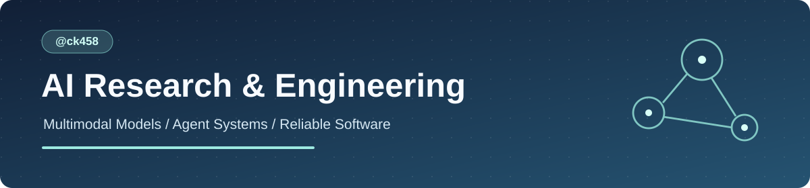

<strong>Multimodal Learning · Research Engineering · Agent Systems · Full-Stack Products</strong>

<a href="README.md">简体中文</a> · <a href="docs/project-index.md">Project Guide</a> · <a href="docs/code-gallery.md">Selected Code</a> · <a href="docs/engineering-evidence.md">Evidence</a>

# ck458 | AI Research & Engineering

B.Sc. in Data Science and Big Data Technology, Nanjing University of Science and Technology (Class of 2027). Admitted to postgraduate study.

I build controlled ML experiments and reliable AI applications. My work spans multimodal post-training, evaluation, agent orchestration, and full-stack software.

## Highlights

| Achievement | Evidence |
| --- | --- |
| **ICONIP 2026 · Oral** | First-author paper on continuous-time dynamic graph anomaly detection |
| **Best AUPRC on 4/4 real datasets** | REVEAL; +61.7% relative AUPRC versus official SLADE on BitcoinOTC |
| **95.6% / 57.79%** | Qwen3-VL-2B, ScienceQA test / MMStar clean, matched answer-only training |
| **544 automated tests** | Novel Engine, cross-platform Windows and Ubuntu |
| **24 API route modules** | Study Logs, a full-stack productivity application |

## Featured work

### [01 · Novel Engine | Reliable Agent Workflow](projects/novel-engine.md)
**Personal project lead · Python / Model Adapters / SQLite / CI**
- Designed a multi-stage workflow spanning context retrieval, planning, generation, evidence extraction, review and durable commit.
- Built checkpointed execution, integrity verification, state recovery, usage accounting and structured model interfaces.
- Validated a 10-chapter isolated workflow and **544 automated tests** across Windows and Ubuntu.

### [02 · Qwen3-VL 8B→2B | Multimodal Distillation](projects/vlm-distillation.md)
**Research & implementation · PyTorch / LoRA / Slurm / Evaluation**
- Built teacher-output auditing, versioned datasets, controlled training, visual interventions and paired statistical reports.
- Evaluated ScienceQA and a 1,431-sample clean external split of MMStar.
- Achieved **95.6% ScienceQA test** and **57.79% MMStar clean** with the matched answer-only student.

### [03 · REVEAL | Temporal Graph Anomaly Detection](projects/reveal.md)
**First author · Research design and experimental implementation**
- Developed evidence-conditioned residual scoring for continuous-time anomaly detection.
- Designed anomaly-injection benchmarks, reproduced baselines and ran 5 independent evaluations.
- **ICONIP 2026 Oral**; best AUPRC across four real-world datasets.

### [04 · Study Logs | Full-Stack AI Productivity](projects/study-logs.md)
**Independent product engineering · Next.js / React / TypeScript / API architecture**
- Built daily planning, time tracking, personal notes, historical records and AI-context aggregation.
- Organized **24 API route modules**, **13 page entries**, business validation and structured data export.

**Additional projects:** [TGN × CERT](projects/tgn-cert.md) · [CICIDS2017](projects/cicids2017.md) ([public code](https://github.com/ck458/CICIDS2017)).

## Technical stack

Python · PyTorch · LoRA/SFT · Slurm · Research Evaluation · SQLite · Agent Workflows · TypeScript · React · Next.js · Git / CI

## Curated code

[Workspace boundary](samples/novel-engine/workspace_paths.py) · [Atomic writes](samples/novel-engine/io_utils.py) · [Paired bootstrap](samples/evaluation/paired_bootstrap.py) · [Date utilities](samples/study-logs/period.ts)

[Role-oriented guide](docs/project-index.md) · [Architecture](docs/system-architecture.md) · [Research & engineering evidence](docs/engineering-evidence.md)

**Contact:** [GitHub @ck458](https://github.com/ck458) · © 2026 ck458
